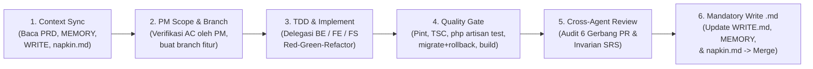

# Agent Guidelines, 3-Phase Plan & Execution Lifecycle (AGENTS.md)

Dokumen ini adalah **konstitusi operasional dan rencana eksekusi 3 Phase** bagi Primary Agent dan seluruh Subagent yang bekerja membangun sistem **CleanWash** berdasarkan [PRD.md](file:///home/yoga/Data/Kuliah/Sistem%20Informasi/PRD.md) dan dokumen SRS ([UTS.pdf](file:///home/yoga/Data/Kuliah/Sistem%20Informasi/Archive/Outputtts/UTS.pdf)).

---

## 1. Hukum Dasar & Rujukan Standar Rekayasa

Setiap AI Agent yang beroperasi di repositori ini **wajib mematuhi**:
1. **Konstitusi Global**: [agent-constitution.md](file:///home/yoga/Data/AGENTS/rules/agent-constitution.md) (*Verify Before Assuming, Root-Cause Over Symptom, Preservation of Working Systems, Zero Hallucination, Autonomous Verification*).
2. **Keandalan Terminal**: [terminal-and-tool-reliability.md](file:///home/yoga/Data/AGENTS/rules/terminal-and-tool-reliability.md) (selalu gunakan flag non-interaktif, jangan jalankan command yang menggantung menunggu TTY).
3. **Metodologi Inti**:
   - TDD Red–Green–Refactor: [test-driven-development/SKILL.md](file:///home/yoga/Data/AGENTS/skills/test-driven-development/SKILL.md)
   - Investigasi Bug Ilmiah: [systematic-debugging/SKILL.md](file:///home/yoga/Data/AGENTS/skills/systematic-debugging/SKILL.md)
   - Audit Mutu Kode: [code-review-and-refactoring/SKILL.md](file:///home/yoga/Data/AGENTS/skills/code-review-and-refactoring/SKILL.md)
   - Orkestrasi Subagent: [subagent-orchestration/SKILL.md](file:///home/yoga/Data/AGENTS/skills/subagent-orchestration/SKILL.md)
4. **Sistem Memori & Quality Gate Proyek**:
   - Skill Napkin: [napkin/SKILL.md](file:///home/yoga/Data/Kuliah/Sistem%20Informasi/napkin/SKILL.md)
   - Live Runbook: [.claude/napkin.md](file:///home/yoga/Data/Kuliah/Sistem%20Informasi/.claude/napkin.md)
   - 6 Gerbang PR & Review: [napkin/PR_REVIEW_LIFECYCLE.md](file:///home/yoga/Data/Kuliah/Sistem%20Informasi/napkin/PR_REVIEW_LIFECYCLE.md)
   - Project Snapshot & ADR: [MEMORY.md](file:///home/yoga/Data/Kuliah/Sistem%20Informasi/MEMORY.md)
   - **Buku Catatan Aktivitas Wajib (Anti-Hilang Konteks)**: [WRITE.md](file:///home/yoga/Data/Kuliah/Sistem%20Informasi/WRITE.md)

---

## 2. Protokol Anti-Hilang Konteks (Hukum Wajib Tulis `.md`)

AI Agent dilarang keras mengandalkan memori percakapan sementara (*ephemeral chat memory*). Untuk menjamin **zero context loss** lintas sesi dan lintas subagent:

### 2.1 Pemisahan Fungsi 3 File Memori (Jangan Tertukar!)
| File | Fungsi | Kapan Wajib Diperbarui |
| --- | --- | --- |
| **[WRITE.md](file:///home/yoga/Data/Kuliah/Sistem%20Informasi/WRITE.md)** | **Ledger Aktivitas & Handoff Sesi**: mencatat apa yang baru dikerjakan, file yang diubah, bukti perintah/test, blocker, dan langkah berikutnya yang eksak (*next exact action*). | **WAJIB HUKUMNYA setiap selesai melakukan kegiatan/subtask, sebelum handoff ke subagent lain, atau sebelum mengakhiri giliran.** |
| **[MEMORY.md](file:///home/yoga/Data/Kuliah/Sistem%20Informasi/MEMORY.md)** | **Snapshot Arsitektur & Status Phase**: mencatat ADR baru, status checklist Phase 1–3 (`NOT_STARTED` / `IN_PROGRESS` / `BLOCKED` / `DONE`), dan ringkasan milestone. | Setiap selesai 1 task/feature besar, perubahan keputusan arsitektur (ADR), atau pergantian Phase. |
| **[.claude/napkin.md](file:///home/yoga/Data/Kuliah/Sistem%20Informasi/.claude/napkin.md)** | **Curated Operational Runbook**: berisi gotcha teknis, koreksi user, dan aturan berulang dalam format `[YYYY-MM-DD]` + `Do instead:` (maks 10 item per kategori). | Setiap menemukan bug berulang, keanehan toolchain (Laravel/MySQL/Inertia), atau aturan baru. |

### 2.2 Aturan Emas Wajib Baca & Wajib Tulis
1. **Awal Sesi / Sebelum Bertindak**: Agent **wajib membaca** `PRD.md` (bagian terkait), `MEMORY.md`, `WRITE.md` (minimal 3 entri terakhir), dan `.claude/napkin.md`.
2. **Akhir Kegiatan (Non-Negotiable Gate)**: Sebuah kegiatan atau delegasi subagent **tidak sah dinyatakan selesai** apabila agent belum menuliskan entri terbaru di **`WRITE.md`**.
3. **Jika Ukuran `WRITE.md` Membesar (> 30 entri)**: Arsipkan entri lama (entri #1 s.d. #20) ke `docs/logs/ARCHIVE_YYYY-MM.md` sambil menyisakan ringkasan eksekutif dan 10 entri terbaru di `WRITE.md`.

---

## 3. Siklus Kerja 6 Tahap (Closed-Loop Execution Lifecycle)

Agar pekerjaan selalu tepat sasaran, rapi, dan bebas regresi, setiap fitur atau bugfix wajib melewati siklus 6 tahap berikut:

### Detail Checklist Tiap Tahap
1. **Tahap 1 — Context Sync**: Baca `PRD.md`, `MEMORY.md`, `WRITE.md`, `.claude/napkin.md`, dan verifikasi posisi phase aktif.
2. **Tahap 2 — PM Scoping & Branching**: Subagent `product-manager` memverifikasi ruang lingkup task, *acceptance criteria* (AC) dari SRS/PRD, dan dependensinya. Pastikan bekerja di branch fitur (`git switch -c feature/<id>-<slug>`), dilarang commit langsung ke `main`.
3. **Tahap 3 — TDD & Implementasi**:
   - Ikuti urutan **Red** (tulis test gagal sesuai kontrak AC/Kondisi Khusus) $\rightarrow$ **Green** (implementasi kode bersih/modular) $\rightarrow$ **Refactor**.
   - Delegasikan tugas sesuai batas keahlian subagent (`backend-developer`, `frontend-developer`, `fullstack-developer`).
4. **Tahap 4 — Automated Quality Gate**: Jalankan seluruh verifikasi lokal ([napkin/PR_REVIEW_LIFECYCLE.md](file:///home/yoga/Data/Kuliah/Sistem%20Informasi/napkin/PR_REVIEW_LIFECYCLE.md)) dan pastikan **exit code 0** (`./vendor/bin/pint --test`, `npx tsc --noEmit`, `php artisan test`, `npm run build`).
5. **Tahap 5 — Cross-Agent / Adversarial Review**: Agent pembuat kode **dilarang** menyetujui pekerjaannya sendiri. Minta `product-manager` (untuk audit AC/SRS) dan/atau `fullstack-developer` / `backend-developer` (untuk audit keamanan, query N+1, migrasi, dan tipe kontrak) meninjau perubahan.
6. **Tahap 6 — Mandatory Write `.md` & Handoff/Merge**:
   - **Wajib tulis `WRITE.md`** dengan bukti perintah uji dan langkah berikutnya.
   - Perbarui `MEMORY.md` jika status task/phase berubah atau ada ADR baru.
   - Perbarui `.claude/napkin.md` jika ada pelajaran berulang baru.
   - Setelah seluruh item pada phase berstatus `[x]`, `product-manager` mengeksekusi **Phase Closing Gate** sebelum masuk ke Phase berikutnya.

---

## 4. Orkestrasi & Spesifikasi 6 Subagent

Definisi lengkap instruksi masing-masing subagent tersimpan permanen di `.agents/agents/` (serta di-symlink ke `.claude/agents/` untuk kompatibilitas lintas CLI). Saat memanggil `define_subagent` / `invoke_subagent`, Primary Agent wajib memuat isi file `.agents/agents/<role>.md` yang sesuai.

| Subagent | File Spesifikasi | Fokus Utama | Kepemilikan File / Direktori Eksklusif | Larangan Tegas |
| --- | --- | --- | --- | --- |
| **`product-manager`** | [product-manager.md](file:///home/yoga/Data/Kuliah/Sistem%20Informasi/.agents/agents/product-manager.md) | Break-down task phase, verifikasi SRS/PRD AC, uji skenario bisnis, *Phase Gate Sign-off* | `PRD.md`, `MEMORY.md`, `WRITE.md`, `docs/phases/*` | Dilarang mengedit source code aplikasi (`app/`, `resources/js/`, `database/`) secara langsung. |
| **`ui-ux-designer`** | [ui-ux-designer.md](file:///home/yoga/Data/Kuliah/Sistem%20Informasi/.agents/agents/ui-ux-designer.md) | Audit visual & UX lintas peran, Design System (`docs/design/*`), hierarki layout, aksesibilitas WCAG AA, *visual sign-off* | `docs/design/*`, `WRITE.md`, `.claude/napkin.md` | Dilarang mengedit backend PHP/DB maupun mengubah kode React/CSS secara sepihak tanpa handoff ke `frontend-developer`. |
| **`backend-developer`** | [backend-developer.md](file:///home/yoga/Data/Kuliah/Sistem%20Informasi/.agents/agents/backend-developer.md) | Migrasi MySQL 8.4, Eloquent Models, Service Layer, FormRequests, Policies, Controllers, Pest/PHPUnit Tests | `app/`, `database/`, `routes/`, `tests/` | Dilarang memodifikasi komponen UI React (`resources/js/`) atau melewati pengujian `php artisan test`. |
| **`frontend-developer`** | [frontend-developer.md](file:///home/yoga/Data/Kuliah/Sistem%20Informasi/.agents/agents/frontend-developer.md) | Halaman Inertia React, komponen UI/UX per peran, Tailwind CSS, TypeScript types, validasi form & UI tests | `resources/js/`, `resources/css/`, `resources/views/`, `tests/Frontend/` (jika ada) | Dilarang menaruh logika otorisasi/kalkulasi harga final yang menimpa backend. |
| **`fullstack-developer`** | [fullstack-developer.md](file:///home/yoga/Data/Kuliah/Sistem%20Informasi/.agents/agents/fullstack-developer.md) | Wiring end-to-end BE–FE, Auth & RBAC flow, cetak Nota/laporan, E2E test, CI/Docker/env, bugfix lintas layer | `routes/web.php`, `bootstrap/`, `config/`, `.github/`, root config (`composer.json`, `package.json`, `vite.config.*`) | Wajib menghormati service backend sebagai *system of record* dan meninjau kontrak tipe FE–BE. |
| **`qa-engineer`** | [qa-engineer.md](file:///home/yoga/Data/Kuliah/Sistem%20Informasi/.agents/agents/qa-engineer.md) | Live browser Playwright regression suite, inspeksi visual & screenshot bukti per langkah, audit `console`/network error, bug triage, & QA report | `playwright.config.ts`, `tests/e2e/*`, `docs/qa/*` | Dilarang mengedit kode produksi (`app/`, `resources/js/`, `routes/`) atau menggunakan mock API pada regression browser test. |

> **Aturan Anti-Konflik Paralel & Siklus UI**: Jika `backend-developer` dan `frontend-developer` dijalankan secara paralel pada satu fitur yang sama, `product-manager` atau `fullstack-developer` wajib mengunci **kontrak JSON/Inertia props** di dokumen task terlebih dahulu sebelum keduanya menyentuh kode. Untuk pembaruan visual/UX, **`ui-ux-designer`** mengunci spesifikasi di `docs/design/` lebih dulu, **`frontend-developer`** mengimplementasikannya, lalu **`qa-engineer` + `ui-ux-designer`** memverifikasi hasil render *live browser*.

---

## 5. Planning Roadmap Terbagi Menjadi 3 Phase

Seluruh implementasi CleanWash dipecah menjadi **3 Phase terurut**. Phase $N+1$ hanya boleh dimulai setelah **Exit Criteria Phase $N$** diverifikasi lulus oleh `product-manager` dan tercatat di `MEMORY.md` serta `WRITE.md`.

### Phase 1 — Fondasi Sistem, Master Data & Penerimaan Transaksi (DP & Voucher)

**Tujuan**: Menyiapkan kerangka aplikasi Laravel 12 + MySQL 8.4 + Inertia React TS, autentikasi 3 peran staf, skema database penuh, pengelolaan master data, serta alur penerimaan transaksi laundry beserta `DetailPakaian`, *snapshot* tarif, validasi voucher atomik, dan pencatatan DP hingga terbit Nomor Nota.

**Cakupan SRS**: `UC-01` (bagian DP), `UC-03`, `UC-04`, `UC-05`, `UC-06`, `UC-07`, `UC-08`, `UC-09`, `KK-03`, `KK-09`, *Activity 1*, *Sequence 1*.

| Work Package | Subagent Penanggung Jawab | Rincian Deliverable |
| --- | --- | --- |
| **P1-01: Scoping & Contracts** | `product-manager` | Breakdown backlog Phase 1, kunci kontrak payload Inertia/FormRequest, checklist AC Phase 1. |
| **P1-02: Project Scaffolding & CI** | `fullstack-developer` | Setup Laravel 12, MySQL 8.4 `.env.example`, Pint, Inertia React + TypeScript + Tailwind CSS, `.github/workflows` CI lint & test. |
| **P1-03: Auth, RBAC & Full Schema** | `backend-developer` | Migrasi seluruh 14+ tabel MySQL 8.4 (`DECIMAL(12,2)`), seeder peran (`Petugas`, `Pegawai`, `PetugasPengantaran`), middleware & Laravel Policy. |
| **P1-04: Master CRUD Services & API** | `backend-developer` | CRUD `Pelanggan` (`boleh_bayar_akhir`), `JenisLayanan` + `TahapLayanan` (`perlu_setrika`, `metode_hitung`), `Voucher` + unit tests. |
| **P1-05: Reception, Snapshot & Voucher Engine** | `backend-developer` | `TransaksiService` (`hitungHarga`, salin `harga_satuan_snapshot`), `VoucherService` (`validasiVoucher`, `lockForUpdate`, `tandaiDigunakan`), `PembayaranService` (`catatUangMuka`), + Pest/PHPUnit tests untuk KK-03 & KK-09. |
| **P1-06: UI Master & Loket Kasir** | `frontend-developer` | Login & App Shell berbasis peran; halaman Master Pelanggan, Layanan (+ tahapan), Voucher; Form Penerimaan Nota dinamis (kg vs pcs, multi `DetailPakaian`, cek voucher live, input DP). |
| **P1-07: Wiring Nota & Phase 1 Gate** | `fullstack-developer` + `product-manager` | Halaman detail & cetak Nomor Nota; uji alur end-to-end Penerimaan & DP; review 6 Gerbang; update `MEMORY.md` & `WRITE.md`. |

**Exit Criteria Phase 1**:
- Migrasi dan `migrate:rollback` berjalan bersih di MySQL 8.4.
- Pengubahan harga master `JenisLayanan` terbukti via automated test **tidak mengubah** `total_harga` transaksi yang sudah tercatat (`KK-09`).
- Voucher kedaluwarsa, sudah terpakai, dan klaim bersamaan ditolak dengan pesan jelas (`KK-03`).
- Petugas dapat membuat nota, mencatat DP, dan mencetak nomor nota end-to-end; seluruh test, Pint, TypeScript check, dan `npm run build` lulus 100%.

---

### Phase 2 — Operasional Produksi, Penimbangan Ulang, Penyesuaian & Kompensasi Insiden

**Tujuan**: Mengimplementasikan ruang kerja `Pegawai (Produksi)` beserta penimbangan ulang otomatis, state machine `RiwayatStatusProduksi` dinamis per jenis layanan, fitur perubahan layanan & pembatalan transaksi berbasis tahap produksi, serta pelaporan kerusakan/kehilangan per item pakaian lengkap dengan kalkulasi & pemotongan kompensasi.

**Cakupan SRS**: `UC-10`, `UC-11`, `UC-12`, `UC-13`, `KK-01`, `KK-02`, `KK-04`, `KK-05`, `KK-08`, *Activity 2*, *Sequence 2 & 3*.

| Work Package | Subagent Penanggung Jawab | Rincian Deliverable |
| --- | --- | --- |
| **P2-01: Rules & Edge Case Contract** | `product-manager` | Spesifikasi rinci aturan biaya pembatalan setelah `Dicuci`, batas tahap `ubahLayanan`, dan kebijakan formula `hitungKompensasi`. |
| **P2-02: Production State Machine & Re-weighing** | `backend-developer` | `ProduksiService` (`timbangUlang` $\rightarrow$ `updateBeratTimbangUlang` + hitung ulang harga + update status lunas bila tagihan naik; validasi urutan `RiwayatStatusProduksi` berdasarkan `TahapLayanan`), audit log. |
| **P2-03: Service Change & Cancellation** | `backend-developer` | Implementasi `ubahLayanan()` (validasi tahap berjalan + snapshot tarif baru + selisih biaya) dan `batalkanTransaksi()` (pengecekan tahap `Dicuci` + kebijakan biaya proses) + unit/feature test KK-01, KK-02, KK-08. |
| **P2-04: Incident & Compensation Engine** | `backend-developer` | `KompensasiService` untuk `LaporanKerusakanKehilangan` per `DetailPakaian` (`RUSAK`/`HILANG`), `hitungKompensasi()`, `potongKompensasi()` (termasuk kasus kompensasi > sisa tagihan) + unit/feature test KK-04 & KK-05. |
| **P2-05: UI Antrean Produksi & Insiden** | `frontend-developer` | Papan antrean kerja `Pegawai` (filter status, tombol progres dinamis tanpa tahap setrika untuk sepatu), modal Timbang Ulang, modal Lapor Kerusakan/Kehilangan per `DetailPakaian`, serta kontrol Ubah Layanan/Batal di sisi `Petugas`. |
| **P2-06: Cross-Actor Wiring & Phase 2 Gate** | `fullstack-developer` + `product-manager` | Sinkronisasi alur Pegawai $\leftrightarrow$ Petugas (notifikasi/indikator perubahan berat & laporan insiden di detail nota), E2E feature test Phase 2, update `MEMORY.md` & `WRITE.md`. |

**Exit Criteria Phase 2**:
- Layanan tanpa setrika (mis. Sepatu) terbukti via test tidak bisa dan tidak perlu masuk tahap `Disetrika`.
- Penimbangan ulang otomatis memperbarui total tagihan dan menurunkan status `LUNAS` $\rightarrow$ `BELUM_LUNAS` bila berat aktual bertambah (`KK-01`).
- Perubahan layanan & pembatalan setelah pencucian mematuhi aturan tahap produksi (`KK-02`, `KK-08`).
- Laporan kerusakan/kehilangan tertaut langsung ke `DetailPakaian` spesifik dan memotong saldo tagihan dengan presisi (`KK-04`, `KK-05`).
- Seluruh quality gate lulus 100%.

---

### Phase 3 — Pengantaran Multi-Pelanggan, Pelunasan Akhir, Serah Terima & Hardening

**Tujuan**: Menyelesaikan alur pengantaran kurir multi-pelanggan dan penjadwalan ulang independen, verifikasi serah terima & hak bayar akhir pelanggan, pelunasan akhir, dashboard/audit trail lengkap, serta *production hardening* dan UAT terhadap seluruh SRS CleanWash.

**Cakupan SRS**: `UC-01` (pelunasan), `UC-02`, `UC-14`, `KK-06`, `KK-07`, *Activity 0 & 3*, *Sequence 0 & 4*, NFR & UAT.

| Work Package | Subagent Penanggung Jawab | Rincian Deliverable |
| --- | --- | --- |
| **P3-01: UAT Matrix & Delivery Rules** | `product-manager` | Matriks uji UAT 14 Use Case & 9 Kondisi Khusus serta spesifikasi dashboard & laporan audit akhir. |
| **P3-02: Multi-Customer Delivery Service** | `backend-developer` | `PengantaranService` (`Pengantaran` + `ItemPengantaran` `*..*`), penugasan `PetugasPengantaran`, transisi status berurutan, dan `jadwalkanUlang()` terisolasi per `ItemPengantaran` gagal (`KK-07`). |
| **P3-03: Handover & Final Settlement** | `backend-developer` | `SerahTerimaService` (`cekHakBayarAkhir` memblokir serah terima bila sisa > 0 kecuali `boleh_bayar_akhir = true`), `PembayaranService::catatPelunasan()`, `updateStatusLunas()`, serta endpoint audit & laporan. |
| **P3-04: UI Kurir, Pelunasan & Dashboard** | `frontend-developer` | Workspace `PetugasPengantaran` (daftar rute harian, kartu per item pelanggan, aksi gagal + alasan wajib), modal Serah Terima & Pelunasan Kasir (peringatan piutang untuk pelanggan `boleh_bayar_akhir`), Dashboard KPI & Audit Trail view. |
| **P3-05: Hardening, Security & E2E UAT** | `fullstack-developer` + `product-manager` | Audit keamanan (RBAC lintas role, CSRF, N+1 query check, validasi presisi desimal, backup/restore DB check), verifikasi penuh 14 Use Case & 9 Kondisi Khusus, finalisasi `MEMORY.md` & `WRITE.md`. |

**Exit Criteria Phase 3 (Final Release Ready)**:
- Satu sesi `Pengantaran` dapat memuat banyak `Transaksi` lintas pelanggan, dan gagal antar pada satu pelanggan berhasil dijadwalkan ulang tanpa mengubah status transaksi lainnya (`KK-07`).
- Penyerahan pakaian belum lunas diblokir untuk pelanggan reguler dan diizinkan untuk pelanggan dengan `boleh_bayar_akhir = true` sambil tetap mencatat piutang (`KK-06`).
- Sisa tagihan akhir konsisten (`total_harga - voucher - DP - kompensasi`).
- Seluruh 14 Use Case, 9 Kondisi Khusus, dan 6 Gerbang Kualitas pada [napkin/PR_REVIEW_LIFECYCLE.md](file:///home/yoga/Data/Kuliah/Sistem%20Informasi/napkin/PR_REVIEW_LIFECYCLE.md) lulus 100% dan disetujui oleh `product-manager` serta Owner.
