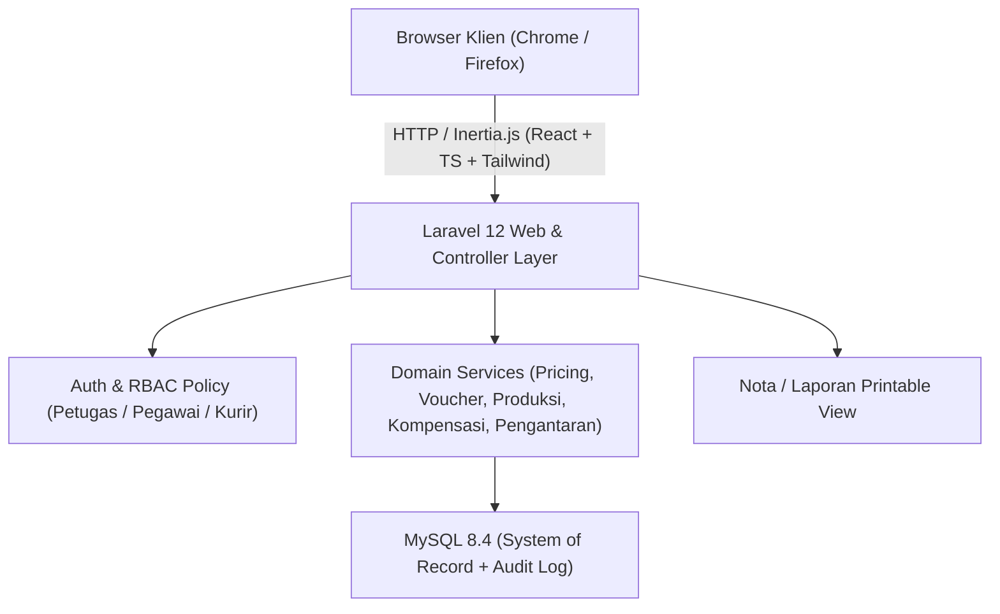
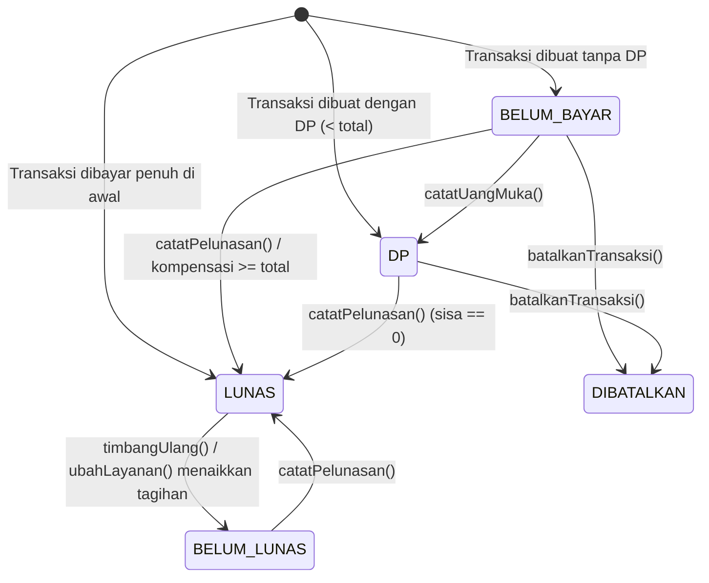
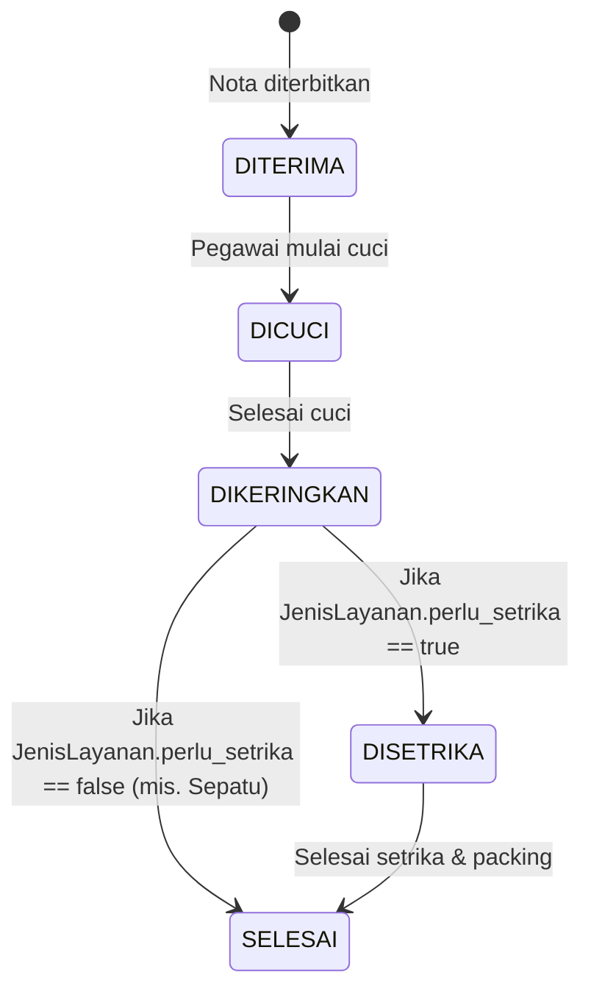
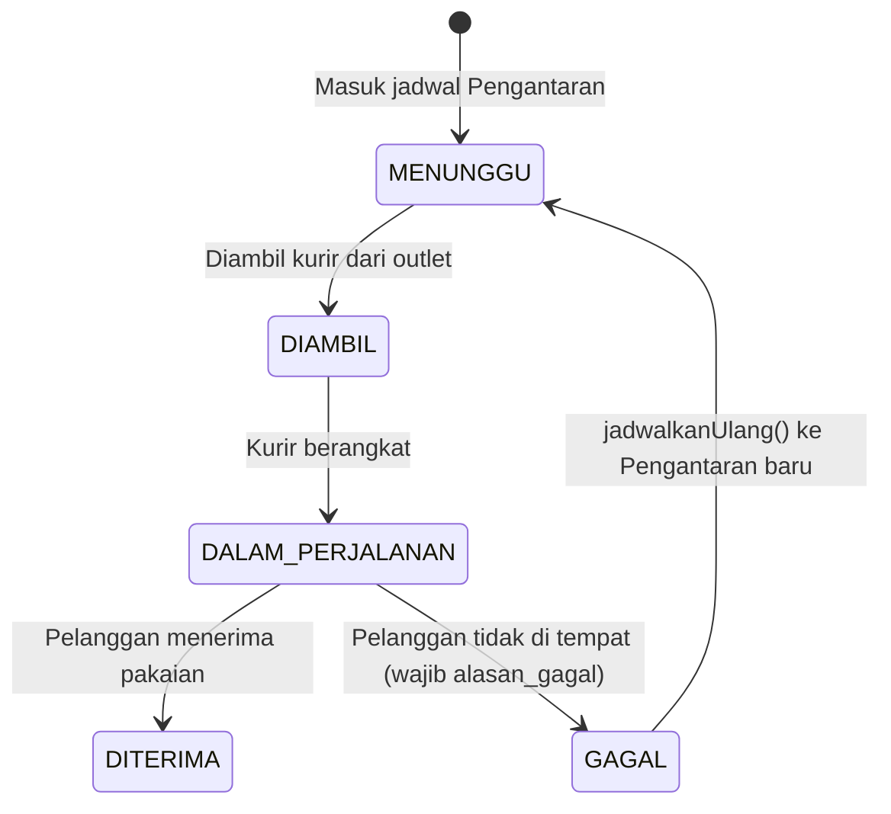

# Product Requirement Document (PRD)

## CleanWash — Sistem Informasi Manajemen Operasional Laundry

| Field | Value |
| --- | --- |
| **Product** | CleanWash |
| **Version** | 1.0 |
| **Status** | Approved Baseline for Phase 1–3 Implementation |
| **Source of Truth (SRS)** | [UTS.pdf](file:///home/yoga/Data/Kuliah/Sistem%20Informasi/Archive/Outputtts/UTS.pdf) & [2UTS_CleanWash_Revisi_Parafrase_Format_Gambar_Jernih.docx](file:///home/yoga/Data/Kuliah/Sistem%20Informasi/Archive/2UTS_CleanWash_Revisi_Parafrase_Format_Gambar_Jernih.docx) |
| **Tech Stack Baseline** | Laravel 12 (PHP 8.2+), MySQL 8.4, Inertia.js (React + TypeScript + Tailwind CSS) |
| **Delivery Plan** | 3 Phase ([AGENTS.md](file:///home/yoga/Data/Kuliah/Sistem%20Informasi/AGENTS.md)) |
| **Author** | Software Analyst / Product Architecture Team |
| **Last Updated** | 2026-11-10 |

---

## 1. Ringkasan Produk

**CleanWash** adalah sistem informasi operasional laundry berbasis web untuk mengelola seluruh siklus layanan laundry—mulai dari penerimaan pakaian di gerai atau penjemputan, pencatatan detail item pakaian, kalkulasi biaya otomatis berdasarkan berat (`kg`) atau jumlah potong (`pcs`) dan tingkat kecepatan (`Reguler` / `Express`), validasi dan penguncian voucher potongan harga, pencatatan uang muka (DP) dan pelunasan, pelacakan status produksi sesuai alur tahapan masing-masing jenis layanan, penimbangan ulang di area produksi, penanganan perubahan layanan dan pembatalan transaksi, pencatatan laporan kerusakan/kehilangan beserta perhitungan kompensasi, hingga pengelolaan pengantaran multi-pelanggan dan verifikasi serah terima berdasarkan hak bayar akhir pelanggan.

Dokumen PRD ini menerjemahkan seluruh rancangan analisis pada dokumen SRS ([UTS.pdf](file:///home/yoga/Data/Kuliah/Sistem%20Informasi/Archive/Outputtts/UTS.pdf) yang memuat *Class Diagram*, *Activity Diagram 0–3*, dan *Sequence Diagram 0–4*, serta spesifikasi naratif di [2UTS_CleanWash_Revisi_Parafrase_Format_Gambar_Jernih.docx](file:///home/yoga/Data/Kuliah/Sistem%20Informasi/Archive/2UTS_CleanWash_Revisi_Parafrase_Format_Gambar_Jernih.docx) dan [Use Case.xmi](file:///home/yoga/Data/Kuliah/Sistem%20Informasi/Archive/Use%20Case.xmi)) menjadi spesifikasi produk yang siap dieksekusi dalam **3 Phase**.

---

## 2. Tujuan dan Indikator Keberhasilan

### 2.1 Tujuan Bisnis & Operasional

1. Menggantikan pencatatan nota manual dengan nomor nota unik yang terhubung ke identitas pelanggan dan riwayat transaksinya.
2. Menjamin ketepatan perhitungan tagihan lintas metode hitung (`BERAT`/`kg` dan `JUMLAH`/`pcs`), tingkat kecepatan (`Reguler`/`Express`), potongan voucher, uang muka (DP), dan kompensasi kerusakan/kehilangan.
3. Menjaga integritas historis tagihan melalui *snapshot* tarif saat transaksi dibuat sehingga pembaruan tarif master tidak mengubah nota lama.
4. Mencegah kecurangan atau kesalahan pemakaian voucher kedaluwarsa dan pemakaian ganda (*double redemption*).
5. Menyelaraskan proses produksi sesuai karakteristik jenis layanan (misalnya layanan sepatu tidak melewati tahap penyetrikaan) serta mencatat audit waktu dan pelaksana pada setiap perpindahan tahap.
6. Mendukung skenario operasional nyata: penimbangan ulang, perubahan layanan, pembatalan transaksi berbasis tahap produksi, pengantaran multi-pelanggan dalam satu sesi kurir, penjadwalan ulang pengantaran gagal secara independen, dan pengecualian hak bayar akhir (`boleh_bayar_akhir`).

### 2.2 Indikator Keberhasilan (Acceptance Metrics)

- **100% ketertelusuran SRS**: Seluruh **14 Use Case**, **13 Class inti** (+ `TahapLayanan`), dan **9 Kondisi Khusus** terimplementasi dan teruji otomatis.
- **0% mutasi harga historis**: Perubahan harga master pada `JenisLayanan` tidak mengubah `total_harga` transaksi yang sudah terbit.
- **0% double-use voucher**: Uji konkurensi/pengulangan klaim pada satu `nomor_voucher` yang sama hanya mengizinkan tepat satu transaksi berhasil.
- **0% serah terima ilegal**: Transaksi belum lunas ditolak penyerahannya oleh sistem kecuali `Pelanggan.boleh_bayar_akhir = true`.
- **100% isolasi kegagalan pengantaran**: Penjadwalan ulang satu `ItemPengantaran` gagal tidak mengubah status item pelanggan lain dalam `Pengantaran` yang sama.

---

## 3. Ruang Lingkup

### 3.1 Termasuk dalam Ruang Lingkup (In-Scope — Phase 1 s.d. 3)

- Autentikasi dan kontrol akses berbasis peran (RBAC) untuk **Petugas (Kasir/Admin)**, **Pegawai (Produksi)**, dan **Petugas Pengantaran (Kurir)**.
- Pengelolaan master data: `Pelanggan` (beserta flag `boleh_bayar_akhir`), `JenisLayanan` (beserta konfigurasi `TahapLayanan` per layanan), dan `Voucher`.
- Penerimaan transaksi laundry dengan komposisi `DetailPakaian` (`1..*`), snapshot tarif (`harga_satuan_snapshot`), kalkulasi biaya otomatis, penerapan voucher (`0..1`), pembayaran bertahap (DP & Pelunasan), dan cetak/tampilan Nomor Nota.
- Antrean produksi `Pegawai`: penimbangan ulang (`updateBeratTimbangUlang`) beserta rekalkulasi tagihan otomatis, serta pembaruan `RiwayatStatusProduksi` tervalidasi sesuai tahapan layanan.
- Penanganan perubahan layanan (`ubahLayanan`) dan pembatalan transaksi (`batalkanTransaksi`) berdasarkan tahapan produksi berjalan.
- Pelaporan insiden kerusakan/kehilangan (`LaporanKerusakanKehilangan`) per `DetailPakaian`, kalkulasi kompensasi, dan pemotongan saldo tagihan transaksi (`potongKompensasi`) atau pencatatan ganti rugi.
- Pengelolaan `Pengantaran` multi-pelanggan melalui `ItemPengantaran`, pelacakan status pengantaran berurutan, pencatatan gagal antar + penjadwalan ulang independen (`jadwalkanUlang`).
- Verifikasi pengambilan langsung/serah terima pakaian (`cekHakBayarAkhir`), pelunasan akhir, serta dashboard operasional dan jejak audit (*audit trail*).

### 3.2 Di Luar Ruang Lingkup (Out-of-Scope V1)

- Portal login mandiri pelanggan / aplikasi mobile native pelanggan (sesuai SRS Q&A #1, *Pelanggan* adalah aktor bisnis pemicu & entitas data; pengoperasian sistem dilakukan oleh *Petugas*, *Pegawai*, dan *Petugas Pengantaran*).
- Integrasi payment gateway otomatis eksternal (pembayaran dicatat sebagai DP / Pelunasan di sistem kasir/kurir).
- Akuntansi buku besar lengkap, payroll pegawai, dan manajemen inventaris bahan habis pakai (detergen/pewangi).
- Multi-cabang / multi-outlet penuh.

---

## 4. Pengguna, Aktor Sistem, dan Hak Akses

Berdasarkan SRS (Use Case Diagram & Identifikasi Aktor), sistem memiliki **4 aktor** dengan pembagian hak akses operasional sebagai berikut:

| Aktor | Tipe Aktor | Tanggung Jawab Utama dalam Sistem | Hak Akses Aplikasi |
| --- | --- | --- | --- |
| **Petugas** (Kasir / Admin) | User Internal (Login) | Mengelola master pelanggan (termasuk `boleh_bayar_akhir`), master jenis layanan & tahapan, master voucher; mencatat penerimaan transaksi & `DetailPakaian`; memvalidasi voucher; mencatat DP & pelunasan; memproses perubahan layanan & pembatalan; mencatat laporan kerusakan/kompensasi; memverifikasi penyerahan pakaian saat diambil. | Full akses operasional loket/kasir, master data, pembayaran, insiden, dan serah terima. |
| **Pegawai** (Produksi) | User Internal (Login) | Melihat antrean cucian produksi; melakukan penimbangan ulang di area produksi (`timbangUlang`); memperbarui tahapan `RiwayatStatusProduksi` sesuai layanan (`Diterima` s.d. `Selesai`); melaporkan insiden kerusakan/kehilangan pakaian. | Akses antrean produksi, form timbang ulang, update status produksi, dan ajukan laporan insiden. Tidak dapat mengubah master tarif/voucher atau mencatat pelunasan kasir. |
| **Petugas Pengantaran** (Kurir) | User Internal (Login) | Mengelola sesi pengantaran (`Pengantaran`) yang berisi banyak transaksi pelanggan (`ItemPengantaran`); memperbarui status pengantaran (`Menunggu` $\rightarrow$ `Diambil` $\rightarrow$ `Dalam Perjalanan` $\rightarrow$ `Diterima` / `Gagal`); mencatat alasan gagal dan menjadwalkan ulang (`jadwalkanUlang`). | Akses daftar jadwal pengantaran ditugaskan, update status per item antar, dan form gagal/jadwalkan ulang. Tidak dapat mengubah master data atau menghapus transaksi. |
| **Pelanggan** | Aktor Bisnis Eksternal & Entitas DB | Menyerahkan pakaian, memilih layanan, menyerahkan voucher, membayar DP & pelunasan, mengambil atau menerima pakaian bersih. | Tidak login ke aplikasi V1; diwakili oleh entitas `pelanggan` dan berinteraksi melalui Petugas / Petugas Pengantaran. |

---

## 5. Matriks Ketertelusuran SRS $\rightarrow$ PRD

### 5.1 Pemetaan 14 Use Case SRS

| No. | Use Case SRS | Aktor | Requirement ID | Target Phase |
| --- | --- | --- | --- | --- |
| UC-01 | Mengelola Pembayaran (DP & Pelunasan) | Petugas | `FR-05`, `FR-11` | Phase 1 (DP) & Phase 3 (Pelunasan) |
| UC-02 | Mengelola Pengambilan Pakaian | Petugas | `FR-11` | Phase 3 |
| UC-03 | Mengelola Voucher | Petugas | `FR-04` | Phase 1 |
| UC-04 | Mengelola Data Pelanggan | Petugas | `FR-01` | Phase 1 |
| UC-05 | Mengelola Jenis Layanan | Petugas | `FR-03` | Phase 1 |
| UC-06 | Mengelola Transaksi Laundry (Base) | Petugas | `FR-02` | Phase 1 |
| UC-07 | Mencatat Detail Pakaian (`<<include>>` UC-06) | Petugas | `FR-02` | Phase 1 |
| UC-08 | Menghitung Biaya Laundry (`<<include>>` UC-06) | Petugas | `FR-03` | Phase 1 |
| UC-09 | Menerapkan Voucher (`<<extend>>` UC-06) | Petugas | `FR-04` | Phase 1 |
| UC-10 | Membatalkan / Mengubah Layanan (`<<extend>>` UC-06) | Petugas | `FR-07`, `FR-12` | Phase 2 |
| UC-11 | Memperbarui Status Produksi (Base) | Pegawai | `FR-06` | Phase 2 |
| UC-12 | Mencatat Penimbangan Ulang (`<<extend>>` UC-11) | Pegawai | `FR-07` | Phase 2 |
| UC-13 | Membuat Laporan Kerusakan/Kehilangan (`<<extend>>` UC-11) | Pegawai / Petugas | `FR-08` | Phase 2 |
| UC-14 | Mengelola Pengantaran & Status (`<<extend>>` Menjadwalkan Ulang) | Petugas Pengantaran | `FR-09`, `FR-10` | Phase 3 |

### 5.2 Pemetaan 9 Kondisi Khusus SRS (Business Edge Cases)

| ID | Kondisi Khusus (SRS) | Aturan Wajib Sistem | Target Phase |
| --- | --- | --- | --- |
| **KK-01** | Berat berubah setelah timbang ulang | `Pegawai` menginput berat aktual; sistem menyimpan berat terbaru pada `Transaksi`, mencatat audit log, dan memicu `hitungHarga()` ulang beserta pembaruan sisa tagihan. | Phase 2 |
| **KK-02** | Perubahan layanan saat proses berjalan | Sistem memeriksa `RiwayatStatusProduksi` terakhir; perubahan layanan hanya diizinkan sebelum melewati batas tahap yang tidak kompatibel (misal belum disetrika/selesai); jika sah, `ubahLayanan()` menyalin `harga_satuan_snapshot` baru dan menghitung selisih tagihan. | Phase 2 |
| **KK-03** | Voucher kedaluwarsa atau sudah terpakai | `validasiVoucher()` wajib menolak voucher dengan `masa_berlaku < tanggal_transaksi` atau `status_penggunaan != TERSEDIA` dengan pesan alasan eksplisit. Klaim sukses mengunci status menjadi `SUDAH_DIGUNAKAN` dalam DB transaction (`SELECT ... FOR UPDATE`). | Phase 1 |
| **KK-04** | Pakaian rusak selama proses | Laporan insiden ditautkan ke `DetailPakaian` spesifik; sistem menghitung kompensasi sesuai jenis pakaian/kebijakan dan memotong sisa tagihan (`potongKompensasi`) atau mencatat kelebihan ganti rugi. | Phase 2 |
| **KK-05** | Pakaian hilang selama proses | Sama seperti KK-04 dengan `jenis_insiden = HILANG`, memicu pencatatan detail item hilang dan kompensasi penuh/kebijakan serta jejak audit petugas/pegawai. | Phase 2 |
| **KK-06** | Pengambilan sebelum pelunasan | `ambilPakaian()` / serah terima memeriksa sisa tagihan. Jika sisa tagihan > 0 dan `Pelanggan.boleh_bayar_akhir == false`, penyerahan **diblokir**. Jika `boleh_bayar_akhir == true`, penyerahan diizinkan dengan status pembayaran tetap `BELUM_LUNAS` (piutang tercatat). | Phase 3 |
| **KK-07** | Pengantaran multi-pelanggan & gagal antar | Satu `Pengantaran` dapat memuat banyak `Transaksi` lewat `ItemPengantaran`. Bila satu pelanggan tidak di tempat, `jadwalkanUlang()` hanya menandai `ItemPengantaran` terkait sebagai `GAGAL` + alasan gagal dan menjadwalkan ulang transaksi tersebut tanpa mengganggu status `ItemPengantaran` lain dalam sesi sama. | Phase 3 |
| **KK-08** | Pembatalan setelah pencucian dimulai | `batalkanTransaksi()` memeriksa `RiwayatStatusProduksi`. Sebelum `Dicuci`: batal penuh tanpa biaya proses (dan voucher dikembalikan `TERSEDIA` bila belum kedaluwarsa, atau sesuai kebijakan). Setelah `Dicuci` dimulai: sistem menolak pembatalan gratis dan menerapkan kebijakan biaya proses berjalan atau penolakan pembatalan setelah tahap `Dikeringkan`/`Disetrika`. | Phase 2 |
| **KK-09** | Harga layanan berubah setelah transaksi dibuat | Pembaruan `harga_satuan` pada master `JenisLayanan` tidak pernah mengubah transaksi yang sudah tercatat karena setiap transaksi menyalin tarif saat dibuat ke `Transaksi.harga_satuan_snapshot`. | Phase 1 |

---

## 6. Arsitektur Sistem & Prinsip Teknis

### Prinsip Arsitektur

1. **Laravel 12 sebagai System of Record**: Seluruh kalkulasi harga, validasi voucher, transisi status produksi, pemotongan kompensasi, dan pengecekan hak bayar akhir **wajib dieksekusi di backend service layer**, bukan hanya di frontend JavaScript.
2. **Pemisahan Layer Tegas (Clean Boundaries)**:
   - Backend (`app/Models`, `app/Services`, `app/Policies`, `app/Http/Requests`, `app/Http/Controllers`, `database/migrations`) menguasai logika bisnis dan persistensi MySQL 8.4.
   - Frontend (`resources/js/Pages`, `resources/js/Components`, `resources/js/Layouts`, `resources/js/types`) menyajikan UI responsif per peran dan pratinjau kalkulasi (*read-only preview*), tanpa mem-bypass validasi server.
3. **Presisi Keuangan & Atomisitas**: Seluruh kolom nominal uang menggunakan tipe `DECIMAL(12,2)` (bukan `FLOAT`/`DOUBLE`). Operasi sensitif balapan (*race condition*) seperti klaim voucher dan pelunasan memakai transaksi database (`DB::transaction`) dan *pessimistic locking* (`lockForUpdate()`).
4. **Auditability Mutlak**: Perubahan berat timbang ulang, ubah layanan, pembatalan transaksi, perpindahan status produksi, laporan kerusakan/kehilangan, dan serah terima dengan `boleh_bayar_akhir` wajib menyimpan timestamp dan `user_id` / aktor pelaksana.

---

## 7. Alur Operasional Utama (End-to-End)

Mengacu pada **Activity Diagram 0–3** dan **Sequence Diagram 0–4** pada [UTS.pdf](file:///home/yoga/Data/Kuliah/Sistem%20Informasi/Archive/Outputtts/UTS.pdf):

### 7.1 Tahap 1 — Penerimaan & Pembayaran Uang Muka (Activity 1 & Sequence 1)
1. `Pelanggan` menyerahkan pakaian, memilih `JenisLayanan`, dan opsional menyerahkan kode `Voucher`.
2. `Petugas` memanggil `getHargaBerlaku(id_layanan)`, memilih/mencatat `Pelanggan`, membuat `Transaksi` (`catatTransaksi`) beserta daftar `DetailPakaian` (`catatItemPakaian`).
3. Sistem menyalin `harga_satuan` ke `harga_satuan_snapshot` dan menghitung tagihan awal (`hitungHarga()`).
4. Jika ada voucher, sistem memvalidasi (`validasiVoucher`) dan menguncinya (`tandaiDigunakan`).
5. `Pelanggan` membayar DP (`bayarUangMuka`), `Petugas` mencatat ke `Pembayaran` (`catatUangMuka`), lalu sistem menerbitkan Nomor Nota dan sisa tagihan (`cetakNota` / `serahkanNota`).

### 7.2 Tahap 2 — Penimbangan Ulang & Produksi (Activity 2 & Sequence 2)
1. `Pegawai` menimbang ulang cucian di area produksi (`timbangUlang(berat_aktual)`).
2. Bila berat berubah, sistem memperbarui `berat_atau_jumlah` (`updateBeratTimbangUlang`) dan memicu `hitungHarga()` ulang secara otomatis serta mencatat riwayat audit.
3. `Pegawai` memindahkan tahapan status pada `RiwayatStatusProduksi` (`ubahStatusProduksi`) secara berurutan sesuai tahapan `JenisLayanan` (contoh: `Diterima` $\rightarrow$ `Dicuci` $\rightarrow$ `Dikeringkan` $\rightarrow$ `Disetrika` [bila `perlu_setrika = true`] $\rightarrow$ `Selesai`).

### 7.3 Tahap 3 — Laporan Kerusakan/Kehilangan & Kompensasi (Activity 2 & Sequence 3)
1. Bila terjadi insiden, `Pegawai` melaporkan insiden ke `Petugas` (`laporkanKerusakan(no_nota, item_id, insiden)`).
2. `Petugas` (atau pelapor terotorisasi) membuat record `LaporanKerusakanKehilangan` tertaut ke `DetailPakaian` terdampak (`buatLaporan`).
3. Sistem menghitung nilai ganti rugi (`hitungKompensasi`) dan memotong saldo tagihan transaksi (`potongKompensasi`) lalu mengonfirmasi saldo tagihan terbaru (`konfirmasiKompensasi`).

### 7.4 Tahap 4 — Pengantaran, Pengambilan & Pelunasan Akhir (Activity 3 & Sequence 4)
1. Untuk layanan antar: `PetugasPengantaran` memulai sesi `Pengantaran` (`mulaiPengantaran`) yang memuat beberapa `Transaksi` melalui `ItemPengantaran`, memperbarui status item (`Menunggu` $\rightarrow$ `Diambil` $\rightarrow$ `Dalam Perjalanan` $\rightarrow$ `Diterima`). Bila pelanggan tidak berada di tempat, item terkait ditandai gagal beserta alasan dan dijadwalkan ulang (`jadwalkanUlang`) secara independen.
2. Untuk pengambilan/serah terima: `Petugas` memproses `ambilPakaian(no_nota)` dan memanggil `cekHakBayarAkhir()`.
3. Jika sisa tagihan > 0 dan `boleh_bayar_akhir == false`, pelanggan wajib membayar pelunasan (`bayarPelunasan`), dicatat ke `Pembayaran` (`catatPelunasan`), transaksi berubah `LUNAS` (`updateStatusLunas`), lalu pakaian diserahkan (`serahkanPakaian`). Jika `boleh_bayar_akhir == true`, pakaian dapat diserahkan dengan sisa piutang tetap tercatat untuk pelunasan berikutnya.

---

## 8. Kebutuhan Fungsional Rinci

| ID | Kebutuhan Fungsional | Deskripsi & Aturan Validasi |
| --- | --- | --- |
| **FR-01** | **Manajemen Pelanggan** | CRUD data pelanggan (`nama`, `no_telepon`, `alamat`, `boleh_bayar_akhir`). Nomor telepon unik/terindeks, riwayat banyak transaksi terhubung ke `id_pelanggan`. |
| **FR-02** | **Transaksi Penerimaan & Detail Pakaian** | Membuat `Transaksi` dengan `nomor_nota` unik (format terstandar, misal `CW-YYYYMMDD-XXXX`), `tanggal_penerimaan`, `berat_atau_jumlah`, `catatan_khusus`, dan minimal 1 baris `DetailPakaian` (`jenis_pakaian`, `jumlah_potong`, `kondisi_pakaian`). |
| **FR-03** | **Master Jenis Layanan & Kalkulasi Harga** | CRUD `JenisLayanan` (`nama_layanan`, `tingkat_kecepatan`: `REGULER`/`EXPRESS`, `metode_hitung`: `BERAT`/`JUMLAH`, `harga_satuan`, `perlu_setrika`, dan daftar `TahapLayanan`). Formula: `subtotal = berat_atau_jumlah * harga_satuan_snapshot`; `total_harga = max(0, subtotal - nilai_voucher - total_kompensasi + biaya_batal_jika_ada)`. |
| **FR-04** | **Manajemen & Validasi Voucher** | CRUD `Voucher` (`nomor_voucher` PK/unik, `nilai`, `masa_berlaku`, `status_penggunaan`: `TERSEDIA`, `SUDAH_DIGUNAKAN`, `KEDALUWARSA`). Maksimal 1 voucher per transaksi dan 1 voucher hanya untuk 1 transaksi. |
| **FR-05** | **Pembayaran Bertahap (DP & Pelunasan)** | Mencatat record `Pembayaran` (`jenis_bayar`: `DP`, `PELUNASAN`, `tanggal_bayar`, `nominal_bayar`). Menghitung `total_dibayar` dan `sisa_tagihan = max(0, total_harga - total_dibayar)`. |
| **FR-06** | **Pelacakan Tahapan Produksi Dinamis** | Setiap `JenisLayanan` mendefinisikan urutan `TahapLayanan` yang sah (contoh: sepatu tanpa `Disetrika`). Transisi status oleh `Pegawai` wajib mengikuti urutan valid dan tersimpan ke `RiwayatStatusProduksi` dengan `waktu_update` dan `id_pegawai`. |
| **FR-07** | **Timbang Ulang & Perubahan Layanan** | `Pegawai` dapat merevisi `berat_aktual` sebelum proses selesai (`timbangUlang`) yang memperbarui `total_harga` dan `status_pembayaran` (bila tadinya lunas namun tagihan bertambah, status kembali `BELUM_LUNAS`). `Petugas` dapat memanggil `ubahLayanan()` dengan validasi tahap produksi terakhir dan penyesuaian selisih biaya. |
| **FR-08** | **Laporan Kerusakan / Kehilangan & Kompensasi** | Mencatat `LaporanKerusakanKehilangan` terhubung ke `Transaksi` dan `DetailPakaian` terdampak (`jenis_insiden`: `RUSAK`/`HILANG`, `keterangan`, `nilai_kompensasi`). Kompensasi otomatis memotong `sisa_tagihan`; jika nilai kompensasi melebihi sisa tagihan, selisihnya dicatat sebagai `kelebihan_kompensasi_tunai` yang harus dibayarkan ke pelanggan. |
| **FR-09** | **Manajemen Pengantaran Multi-Pelanggan** | `Petugas` atau `PetugasPengantaran` membuat sesi `Pengantaran` (`tanggal_pengantaran`, `id_petugas_antar`, `status_pengantaran`) yang dapat menampung 1 atau lebih `Transaksi` siap antar via `ItemPengantaran`. |
| **FR-10** | **Status Pengantaran & Penjadwalan Ulang** | Update status per item/sesi (`MENUNGGU` $\rightarrow$ `DIAMBIL` $\rightarrow$ `DALAM_PERJALANAN` $\rightarrow$ `DITERIMA` atau `GAGAL`). Bila `GAGAL`, wajib mengisi `alasan_gagal` dan memicu `jadwalkanUlang()` untuk transaksi tersebut tanpa memengaruhi item lain. |
| **FR-11** | **Pengambilan Pakaian & Cek Hak Bayar Akhir** | Verifikasi serah terima di kasir atau kurir: cek `sisa_tagihan == 0` atau `Pelanggan.boleh_bayar_akhir == true`. Catat timestamp serah terima dan petugas penyerah. |
| **FR-12** | **Pembatalan Transaksi & Snapshot Tarif** | `batalkanTransaksi()` mengecek `RiwayatStatusProduksi`: sebelum `Dicuci` dapat dibatalkan penuh (`DIBATALKAN`); setelah `Dicuci` dikenai biaya proses sesuai kebijakan atau ditolak jika sudah mencapai tahap akhir (`Dikeringkan`/`Disetrika`/`Selesai`). `harga_satuan_snapshot` selalu dikunci pada saat transaksi dibuat/diubah layanan. |

---

## 9. State Machine & Invarian Domain

### 9.1 Status Transaksi & Pembayaran

### 9.2 Status Produksi Dinamis per Layanan

### 9.3 Status Pengantaran per `ItemPengantaran`

---

## 10. Model Data Inti (MySQL 8.4)

Mengikuti **Class Diagram (`UTS.pdf` Halaman 1)** dan jawaban studi kasus SRS:

| Tabel / Entitas | Kolom Inti & Relasi | Catatan Teknis |
| --- | --- | --- |
| `users` | `id`, `name`, `email`, `password`, `role` (`PETUGAS`, `PEGAWAI`, `PENGANTAR`), `is_active` | Memetakan akun login ke profil aktor terkait (`petugas`, `pegawai`, `petugas_pengantaran`) atau menyatukan identitas login staf. |
| `pelanggan` | `id_pelanggan` (PK), `nama`, `no_telepon` (unique/index), `alamat`, `boleh_bayar_akhir` (boolean default false) | Menyimpan hak bayar akhir pelanggan. |
| `petugas` | `id_petugas` (PK), `user_id` (FK unique), `nama_petugas` | Aktor kasir/admin sesuai Class Diagram. |
| `pegawai` | `id_pegawai` (PK), `user_id` (FK unique), `nama_pegawai` | Aktor produksi sesuai Class Diagram. |
| `petugas_pengantaran` | `id_petugas_antar` (PK), `user_id` (FK unique), `nama_petugas_antar` | Aktor kurir sesuai Class Diagram. |
| `jenis_layanan` | `id_layanan` (PK), `nama_layanan`, `tingkat_kecepatan` (`REGULER`/`EXPRESS`), `metode_hitung` (`BERAT`/`JUMLAH`), `satuan` (`kg`/`pcs`), `harga_satuan` (`DECIMAL(12,2)`), `perlu_setrika` (boolean) | Master layanan & tarif berlaku. |
| `tahap_layanan` | `id_tahap` (PK), `id_layanan` (FK), `nama_tahap`, `urutan` (int) | Mengatur urutan tahap valid per jenis layanan (mis. Sepatu tanpa tahap `Disetrika`). |
| `voucher` | `nomor_voucher` (PK string), `nilai` (`DECIMAL(12,2)`), `masa_berlaku` (`DATE`), `status_penggunaan` (`TERSEDIA`/`SUDAH_DIGUNAKAN`/`KEDALUWARSA`) | Relasi `0..1` ke `transaksi`. |
| `transaksi` | `nomor_nota` (PK / unique code + `id`), `id_pelanggan` (FK), `id_petugas` (FK), `id_layanan` (FK), `nomor_voucher` (FK nullable unique), `tanggal_penerimaan`, `berat_atau_jumlah` (`DECIMAL(8,2)`), `catatan_khusus`, `harga_satuan_snapshot` (`DECIMAL(12,2)`), `nilai_voucher_snapshot` (`DECIMAL(12,2)`), `total_kompensasi` (`DECIMAL(12,2)`), `biaya_pembatalan` (`DECIMAL(12,2)`), `total_harga` (`DECIMAL(12,2)`), `status_pembayaran`, `status_transaksi` (`AKTIF`/`SELESAI`/`DIAMBIL`/`DIBATALKAN`), `diambil_pada` (nullable timestamp) | Header transaksi & snapshot tarif. |
| `detail_pakaian` | `id_detail` (PK), `nomor_nota` (FK cascade), `jenis_pakaian`, `jumlah_potong`, `kondisi_pakaian` | Relasi komposisi `1..*` milik `transaksi`. |
| `pembayaran` | `id_pembayaran` (PK), `nomor_nota` (FK), `id_petugas` (FK), `tanggal_bayar`, `jenis_bayar` (`DP`/`PELUNASAN`), `nominal_bayar` (`DECIMAL(12,2)`) | Mencatat seluruh riwayat pembayaran bertahap. |
| `riwayat_status_produksi` | `id_status_produksi` (PK), `nomor_nota` (FK), `id_pegawai` (FK), `tahap_status`, `waktu_update`, `catatan` | Jejak riwayat perubahan status produksi. |
| `laporan_kerusakan_kehilangan` | `id_laporan` (PK), `nomor_nota` (FK), `id_detail` (FK ke `detail_pakaian`), `id_petugas` (FK), `id_pegawai_pelapor` (FK nullable), `jenis_insiden` (`RUSAK`/`HILANG`), `keterangan`, `nilai_kompensasi` (`DECIMAL(12,2)`), `kelebihan_ganti_rugi` (`DECIMAL(12,2)`), `created_at` | Tertaut spesifik ke item pakaian terdampak. |
| `pengantaran` | `id_pengantaran` (PK), `id_petugas_antar` (FK), `tanggal_pengantaran`, `status_pengantaran` (`DIJADWALKAN`/`BERJALAN`/`SELESAI`) | Satu keberangkatan oleh seorang kurir. |
| `item_pengantaran` | `id_item_antar` (PK), `id_pengantaran` (FK), `nomor_nota` (FK), `status_terima_pelanggan` (`MENUNGGU`/`DIAMBIL`/`DALAM_PERJALANAN`/`DITERIMA`/`GAGAL`), `alasan_gagal` (nullable), `waktu_update` | Tabel asosiasi `*..*` antara `transaksi` dan `pengantaran`. |
| `audit_logs` | `id`, `user_id`, `actor_role`, `action`, `subject_type`, `subject_id`, `payload_before` (JSON), `payload_after` (JSON), `created_at` | Pencatatan audit untuk timbang ulang, ubah layanan, batal, insiden, dan serah terima. |

---

## 11. Kontrak Route / Endpoint Minimum

| Area | Route / Endpoint | Aktor Berwenang | Fungsi Utama |
| --- | --- | --- | --- |
| Auth | `GET/POST /login`, `POST /logout` | Semua Staf | Autentikasi sesi & redirect dashboard peran |
| Master Pelanggan | `RESOURCE /pelanggan` | Petugas | CRUD pelanggan + toggle `boleh_bayar_akhir` |
| Master Layanan | `RESOURCE /layanan` | Petugas | CRUD jenis layanan + tahapan produksi |
| Master Voucher | `RESOURCE /voucher` | Petugas | CRUD & cek status voucher |
| Transaksi | `GET/POST /transaksi`, `GET /transaksi/{nota}`, `GET /transaksi/{nota}/nota` | Petugas | Buat transaksi + detail pakaian, DP, cetak nota |
| Voucher Validasi | `POST /voucher/validate` | Petugas | Validasi voucher real-time sebelum simpan |
| Penyesuaian Nota | `POST /transaksi/{nota}/ubah-layanan`, `POST /transaksi/{nota}/batalkan` | Petugas | Penyesuaian layanan & pembatalan berbasis tahap |
| Pembayaran & Ambil | `POST /transaksi/{nota}/pembayaran`, `POST /transaksi/{nota}/serah-terima` | Petugas | Catat pelunasan & cek `boleh_bayar_akhir` |
| Produksi | `GET /produksi`, `POST /produksi/{nota}/timbang-ulang`, `POST /produksi/{nota}/status` | Pegawai | Antrean cuci, timbang ulang, update status |
| Insiden | `GET/POST /insiden` (`POST /transaksi/{nota}/insiden`) | Pegawai, Petugas | Lapor kerusakan/kehilangan & hitung/potong kompensasi |
| Pengantaran | `RESOURCE /pengantaran`, `POST /pengantaran/item/{id}/status`, `POST /pengantaran/item/{id}/jadwalkan-ulang` | Petugas (jadwal), Kurir (status) | Pengelompokan nota, update status antar, reschedule gagal |

---

## 12. Kebutuhan Non-Fungsional

1. **Integritas Data & Transaksional**: Operasi multi-tabel (buat transaksi + detail + klaim voucher + DP; timbang ulang + update total; laporan insiden + potong kompensasi) wajib dibungkus `DB::transaction()`.
2. **Keamanan & Otorisasi**: Proteksi CSRF aktif pada seluruh form/Inertia request, mass-assignment protection di semua Model, Laravel Policy/Middleware ketat pada seluruh endpoint agar `Pegawai` atau `PetugasPengantaran` tidak dapat mengakses menu kasir/master atau sebaliknya.
3. **Kinerja & Lingkungan SRS**: Berjalan lancar pada **PHP 8.2+ (Laravel 12)**, **MySQL 8.4**, server minimal 2 core / 4 GB RAM / 50 GB SSD, Web Server Apache/Nginx, browser Chrome/Firefox modern. Query antrean menggunakan eager loading (`with(...)`) untuk mencegah *N+1 query*.
4. **Audit & Zona Waktu**: Seluruh timestamp disimpan konsisten (`Asia/Jakarta` atau UTC terkonfigurasi jelas di `config/app.php`) dan tidak dapat dimanipulasi dari input klien.

---

## 13. Roadmap Implementasi 3 Phase

Detail pembagian task, penugasan 4 subagent, dan exit criteria terdokumentasi di [AGENTS.md](file:///home/yoga/Data/Kuliah/Sistem%20Informasi/AGENTS.md):

1. **Phase 1 — Fondasi Sistem, Master Data & Penerimaan Transaksi (DP & Voucher)**: Setup Laravel 12 + MySQL 8.4 + Inertia React TS + RBAC + Migrasi penuh + Master CRUD + Penerimaan Nota (`DetailPakaian`, `harga_satuan_snapshot`, validasi/lock `Voucher`, DP).
2. **Phase 2 — Operasional Produksi, Penimbangan Ulang, Perubahan Layanan/Pembatalan & Kompensasi Insiden**: Antrean `Pegawai`, `timbangUlang`, state machine `RiwayatStatusProduksi` dinamis per `JenisLayanan`, `ubahLayanan`, `batalkanTransaksi`, serta `LaporanKerusakanKehilangan` + `potongKompensasi`.
3. **Phase 3 — Pengantaran Multi-Pelanggan, Pelunasan Akhir, Serah Terima & Production Hardening**: `Pengantaran` + `ItemPengantaran` multi-transaksi, gagal antar & `jadwalkanUlang`, `cekHakBayarAkhir` & serah terima, pelunasan sisa tagihan, dashboard/audit trail, serta uji E2E/UAT 14 Use Case & 9 Kondisi Khusus.

---

## 14. Strategi Pengujian & Definition of Done (DoD)

### 14.1 Matriks Uji Minimum

- **Pricing & Snapshot**: Layanan `BERAT` vs `JUMLAH`, `REGULER` vs `EXPRESS`, ubah harga master setelah nota terbit (nota lama wajib tetap).
- **Voucher**: Voucher valid (`TERSEDIA`), kedaluwarsa (`masa_berlaku` lewat), sudah dipakai (`SUDAH_DIGUNAKAN`), dan simulasi klaim bersamaan pada satu kode voucher.
- **Produksi & Penyesuaian**: Urutan status untuk layanan dengan `perlu_setrika = true` vs `false` (sepatu); `timbangUlang` memperbarui total & status lunas; `ubahLayanan` & `batalkanTransaksi` ditolak/dikenai biaya bila melampaui tahap batas.
- **Kompensasi & Pelunasan**: Insiden tertaut ke `DetailPakaian`; pemotongan sisa tagihan; skenario kompensasi melebihi sisa tagihan; blokir serah terima bila belum lunas & `boleh_bayar_akhir = false`; lolos serah terima bila `boleh_bayar_akhir = true`.
- **Pengantaran**: Satu `Pengantaran` dengan $\ge 2$ `Transaksi` pelanggan berbeda; satu item `GAGAL` dijadwalkan ulang tanpa merusak status `DITERIMA` pada item lainnya.

### 14.2 Definition of Done (DoD)

Sebuah fitur atau phase dinyatakan **DONE** hanya jika:
1. Seluruh acceptance criteria pada `PRD.md` dan `AGENTS.md` terpenuhi.
2. Gerbang Kualitas pada [napkin/PR_REVIEW_LIFECYCLE.md](file:///home/yoga/Data/Kuliah/Sistem%20Informasi/napkin/PR_REVIEW_LIFECYCLE.md) lulus 100% (Pint, TypeScript check, `php artisan test`, `npm run build`, migrate + rollback test).
3. Tidak ada defect kritikal maupun pelanggaran invarian SRS.
4. `WRITE.md`, `MEMORY.md`, dan `.claude/napkin.md` (jika ada temuan baru) telah diperbarui dengan bukti verifikasi nyata.
